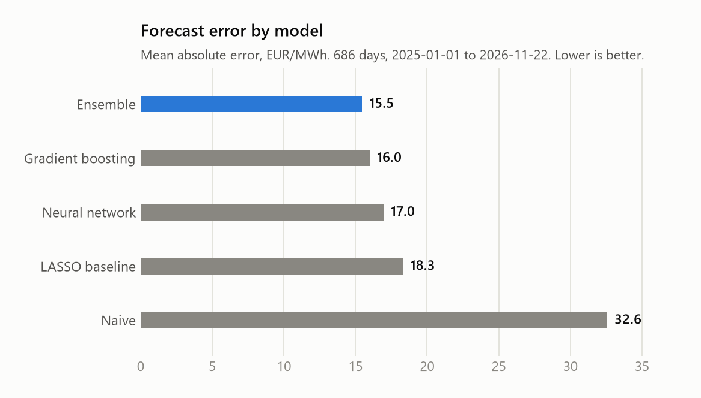
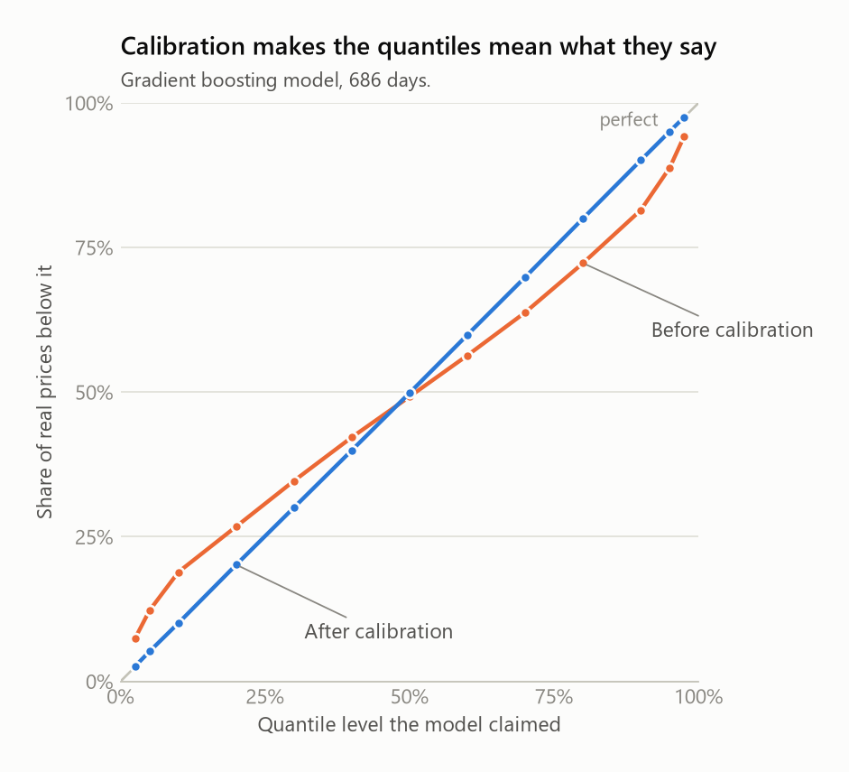
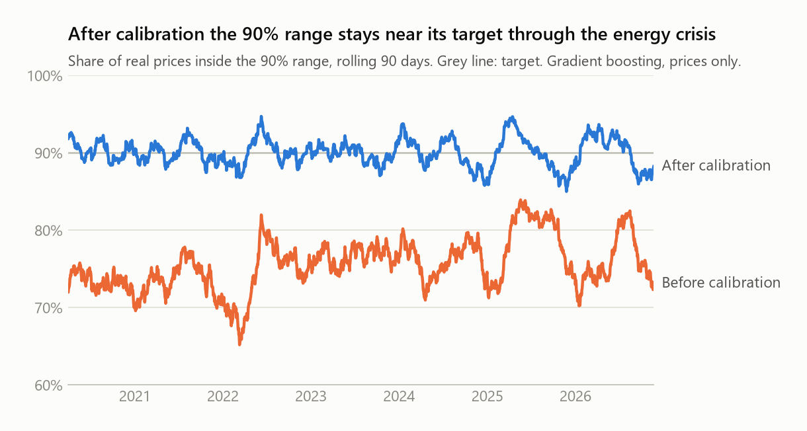
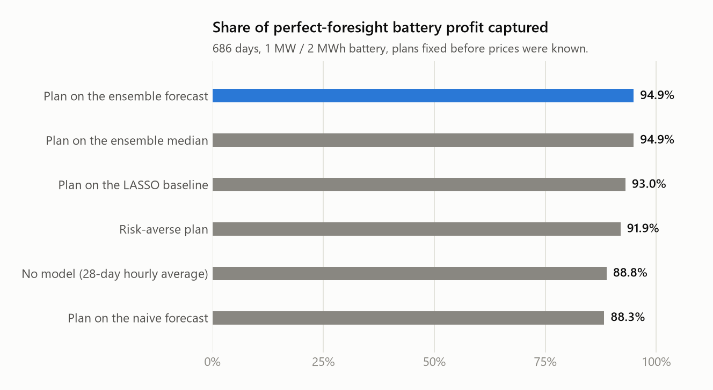
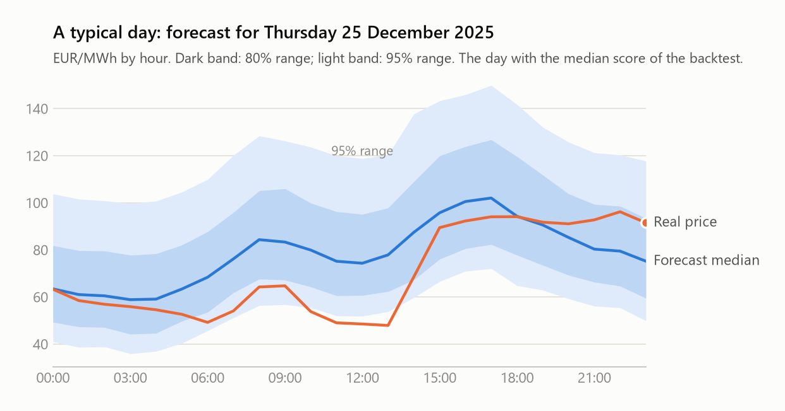

<!-- README.md is generated from this template by `python -m gridwise.report`; edit the template. -->
# GridWise

**Day-ahead electricity price forecasts for Germany with honest uncertainty, turned into a battery
schedule, published before each auction and scored against the real prices every day.**

[](../../actions/workflows/ci.yml)
[](../../actions/workflows/daily.yml)

Germany's power price is set once a day, at noon, for each hour of the next day. A battery operator has
to decide before that auction when to buy and when to sell. This project forecasts tomorrow's 24 prices
as full ranges, checks that the ranges are honest, plans a battery on them, and keeps a public record
that cannot be back-filled: every forecast file is committed before its prices exist.

- **Live dashboard:** [`docs/index.html`](docs/index.html), served with GitHub Pages from the `docs/` folder
- **All numbers, traced to MLflow runs:** [RESULTS.md](RESULTS.md)
- **Data sources, licences, and what is known when:** [DATA.md](DATA.md)
- **Model card:** [MODEL_CARD.md](MODEL_CARD.md)

## Results

Main backtest: __DAYS__ delivery days (__START__ to __END__). Every day was forecast by models fitted on
earlier days only, from inputs that exist before the auction closes.

| Model | Error (MAE, EUR/MWh) | vs naive | CRPS | 90% range holds |
|---|---:|---:|---:|---:|
__MODEL_ROWS__



**Honest ranges.** Before calibration, the boosting model's 90% range held the real price only
__RAW90__ of the time. After online conformal calibration it holds __CAL90__. In the six-year backtest
(__LONG_YEARS__, prices and calendar only) the calibrated 90% range held between __LONG_COV_MIN__ and
__LONG_COV_MAX__ of the time in every single year, including the 2022 energy crisis when prices were
several times higher than the models had ever seen.



The same model over six years, before and after calibration:



**Worth in money.** A simulated 1 MW / 2 MWh battery, planned before prices are known and paid at the real
prices:

| Plan | EUR per day | Share of perfect foresight |
|---|---:|---:|
__POLICY_ROWS__



A typical day (the one with the median score, picked by rule):



## Three things that were hard, and what the project does about them

### 1. Not using information from the future

The standard inputs in the price-forecasting literature are the grid operators' day-ahead forecasts of
load, wind and solar. I checked when they are actually published: on 2026-11-21 at 15:15 local time,
three hours after the auction for the next day had closed, the wind and solar forecasts for that day
were still not on SMARD. A backtest that uses them looks better than anything that could run live:
__LEAK_SENTENCE__

GridWise uses weather forecasts instead, at a lead time that is always available: the value issued 48
hours before each hour (checked hour by hour against single model runs). The config refuses a shorter
lead. Unit tests rewrite all prices from day D onwards and assert that the features of day D do not
change, and assert that every model is fitted only on days before the ones it forecasts.

### 2. Ranges that stay honest when the market changes

Quantile models are over-confident out of the box, and electricity prices change regime. Every day the
calibrator shifts each quantile by what the recent errors say it should have been, and adaptive
conformal inference moves the target level when coverage starts to slip. All of it is done in units
of the recent price spread, so errors from calm and wild weeks are comparable.

### 3. Measuring the forecast in money, and reporting what did not work

Battery profit is linear in price. So the plan that maximises expected profit is simply the plan on the
forecast mean, and no amount of scenario sampling can beat it; a unit test confirms the scenario planner
with zero risk aversion reproduces the mean plan. The only place the full distribution changes the
decision is under risk aversion, so the project also builds joint price scenarios (a Gaussian copula
across the 24 hours) and a CVaR planner. **Result in the main backtest: the risk-averse plan earned less (__CVAR_EUR__ against
__MEAN_EUR__ EUR a day) and did not improve the worst days** (its worst 5% of days averaged
__CVAR_WORST__ EUR, the mean plan's __MEAN_WORST__ EUR). With a good forecast, a battery that only trades
day-ahead rarely loses money, so there was little to insure against. In the six-year backtest, with a
weaker forecast and a wilder market, the same planner did protect the worst days (__LONG_CVAR_WORST__
against __LONG_MEAN_WORST__ EUR) for __LONG_CVAR_COST__ EUR a day less on average. So the honest summary
is: for expected profit the point forecast is all that matters, and risk aversion is a price you pay
for a smoother ride, worth it only when the forecast is weak or the market is rough.

Also worth knowing: a plan that uses no model at all, just the average price of each hour over the last
28 days, already captures __PROFILE_SHARE__ of the perfect-foresight profit. The forecast closes
__GAP_CLOSED__ of the remaining gap.

## How it works

```
SMARD prices ─┐
              ├─► leak-safe features ─► 3 forecasters ─► online conformal ─► ensemble ─► 13 quantiles
Open-Meteo ───┘   (prices to D-1,       LASSO (LEAR)     calibration                     per hour
48 h-lead         weather for D,        LightGBM                                             │
forecasts         calendar)             neural net                                           ▼
                                                              Gaussian copula ─► scenarios ─► battery
                                                                                              optimiser
                                                                                              (MILP)
```

| Step | What | Where |
|---|---|---|
| Data | SMARD chart API with a chunk cache, Energy-Charts as a gap filler, Open-Meteo forecasts at a fixed lead | `src/gridwise/sources/`, `dataset.py` |
| Calendar grid | 23- and 25-hour days mapped to 24 slots for features; money always on real hours | `frames.py` |
| Features | Prices relative to the last week's level and spread, weather proxies for wind, solar and demand, holidays | `features.py` |
| Models | Naive, LASSO in the LEAR style, quantile LightGBM, quantile neural network (PyTorch) | `models/` |
| Calibration | Rolling and adaptive conformal, per quantile level | `conformal.py` |
| Backtest | Rolling origin, refits anchored to the calendar so live and backtest use identical models | `backtest.py` |
| Scenarios | PIT, Gaussian copula across hours, quantile-function sampling | `scenarios.py` |
| Battery | Mixed-integer plan with efficiency, cycle limit and wear cost; CVaR variant | `battery.py` |
| Money study | Seven plans paid at real prices, block-bootstrap confidence intervals | `decide.py` |
| Live job | Forecast, schedule, score, scoreboard, health checks | `live.py`, `monitor.py` |
| Tracking | MLflow; RESULTS.md is generated from recorded run ids | `track.py`, `report.py` |
| Serving | FastAPI over the live record plus a planner endpoint; static dashboard | `serve/api.py`, `docs/` |

## The live system

A GitHub Actions workflow runs at 06:30 UTC every day, hours before the 12:00 auction:

1. refresh the data (only the newest chunks are downloaded);
2. score every earlier forecast whose prices are now published;
3. forecast tomorrow, plan the battery, write `docs/live/forecasts/<day>.json`;
4. run health checks and commit.

Rules that keep the record honest:

- A forecast file is never overwritten. The first forecast of a day is the record.
- A forecast made after its prices were already public is flagged and never scored.
- The job fails loudly, without publishing, if any input for tomorrow is incomplete.
- Each forecast stores the weather values it used; the monitor later checks they match the archive.

## Run it

```bash
uv sync --all-extras
uv run python -m gridwise.dataset                 # download and cache the data (5 to 10 minutes)
bash scripts/run_backtest.sh main                 # backtest, battery study, log to MLflow
uv run python -m gridwise.report                  # write RESULTS.md from MLflow
uv run python -m gridwise.live run                # score past days and forecast tomorrow
uv run pytest                                     # 60+ tests on synthetic data, no downloads
```

API:

```bash
uv run uvicorn gridwise.serve.api:app --port 8000
curl localhost:8000/forecast/latest
curl -X POST localhost:8000/schedule -H "content-type: application/json" \
     -d '{"prices": [40, 35, 30, 45, 90, 120, 110, 60]}'
```

`POST /schedule` plans any battery on any price list, or on a stored forecast (`{"day": "2026-11-23"}`).
Docker: `docker compose up` serves the API on port 8000.

## Limits

- **Day-ahead only.** A real battery also trades intraday and sells balancing services, which is where
  much of its revenue comes from. This is a study of one market, not a revenue model.
- **Price taker, hourly blocks.** The battery is assumed too small to move prices and trades the same
  volume in the four quarters of each hour.
- **No fuel or carbon prices.** Gas and CO2 prices drive the price level; they are not inputs. Prices of
  the previous week carry the level instead.
- **Two years of weather history.** Forecasts at a fixed lead are archived only from February 2024, so
  the main backtest covers 2025 and 2026.
- **Battery numbers are assumptions.** Efficiency, cycle limit and wear cost are stated in the config,
  not measured.
- **No hyperparameter search.** Model settings were fixed up front. Tuning them on this window would
  make the backtest less trustworthy than the small gain is worth.
- **Tails beyond 2.5% and 97.5% are extrapolated,** not modelled.

## References

- Lago, Marcjasz, De Schutter, Weron (2021). Forecasting day-ahead electricity prices: a review of
  state-of-the-art algorithms, best practices and an open-access benchmark. *Applied Energy* 293.
- Romano, Patterson, Candès (2019). Conformalized quantile regression. *NeurIPS*.
- Gibbs, Candès (2021). Adaptive conformal inference under distribution shift. *NeurIPS*.
- Rockafellar, Uryasev (2000). Optimization of conditional value-at-risk. *Journal of Risk* 2.

## Licence and credits

Code: MIT. Prices: Bundesnetzagentur | SMARD.de (CC BY 4.0). Weather: Open-Meteo.com (CC BY 4.0, free API
for non-commercial use). Not trading advice.
